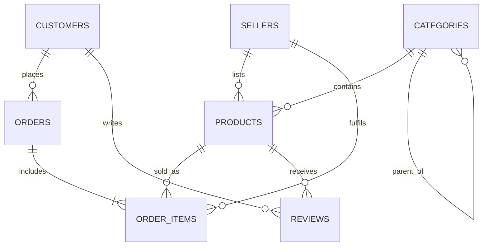

# E-commerce Database Analytics (MySQL)

**Student:** [Jayesh Shrivastava] &nbsp;|&nbsp; **Roll No:** [Your Roll Number - 2501420043 ] &nbsp;|&nbsp; **Problem Statement No:** [Problem Statement No. 3]

A capstone project covering schema design, SQL analytics, cohort analysis, indexing with `EXPLAIN`, views, a simulated
materialized view, and window functions on an e-commerce marketplace (products, sellers, customers, orders, reviews).

> The full report with real query outputs is in [`docs/Capstone_Project_Report.pdf`](docs/Capstone_Project_Report.pdf).
> The data is **synthetic** and generated by SQL itself (deterministic, so every run gives identical results).

## Repository structure

| Path | What it contains |
|------|------------------|
| `sql/00_run_all.sql` | Everything in one script, run top to bottom |
| `sql/01_schema.sql` | Database and 7 tables (PK, FK, CHECK, UNIQUE) |
| `sql/02_sample_data.sql` | Deterministic sample data (5,000 customers, 50,000 orders, 100,000 order lines) and the base view `v_sales_lines` |
| `sql/03_sales_analytics.sql` | Sales trend, top products, customer satisfaction scores |
| `sql/04_cohort_analysis.sql` | Cohort retention matrix, cumulative revenue per cohort, days to second order |
| `sql/05_indexing_explain.sql` | Composite and FULLTEXT indexes, EXPLAIN / EXPLAIN ANALYZE, low-selectivity demo |
| `sql/06_views_and_summary_table.sql` | Seller performance view, customer LTV view, summary table + stored procedure + event |
| `sql/07_window_functions.sql` | RANK, LAG, moving average, MIN() OVER, NTILE |
| `outputs/` | Real output of each SQL file, captured from a MySQL 8.0 server |
| `docs/` | PDF report and ER diagram |

## How to run

Requires **MySQL 8.0+** (window functions, CTEs, `EXPLAIN ANALYZE`).

```bash
# everything at once
mysql -u root -p < sql/00_run_all.sql

# or step by step, in order
mysql -u root -p < sql/01_schema.sql
mysql -u root -p < sql/02_sample_data.sql
mysql -u root -p < sql/03_sales_analytics.sql
# ... 04 to 07
```

Notes: the script creates (and first drops) a database named `shop`. `SET GLOBAL event_scheduler = ON` in file 06 needs an account with
sufficient privileges (the hourly refresh event only runs when the scheduler is on).

## Schema



## What was built

1. **Schema** for product listings, sellers, customers, orders, order items and reviews.
2. **Analytics queries:** monthly sales trend, top-selling products, satisfaction (average rating, % positive, NPS-style index, Bayesian-weighted rating).
3. **Cohort analysis:** first-purchase month cohorts, retention matrix, cumulative revenue per customer, days to second order.
4. **Indexing:** composite indexes `orders(customer_id, order_date)` and `products(category_id, price)`, FULLTEXT on `products(title, description)`;
   before/after `EXPLAIN`; and a demonstration that an index on low-selectivity `orders.status` does not help.
5. **Views:** `v_seller_performance`, `v_customer_ltv`; simulated materialized view `seller_performance_summary` refreshed by
   `sp_refresh_seller_performance()` and an hourly event; trade-off explained.
6. **Window functions:** `RANK() OVER (PARTITION BY ...)`, `LAG()`, 3-month moving average, `MIN() OVER (PARTITION BY customer_id)`, `NTILE(4)`.

## Results (from the included run, MySQL 8.0, synthetic data)

| Query | Without optimisation | With optimisation |
|-------|---------------------:|------------------:|
| Customer's orders in a date range (composite index) | 8.94 ms | 0.20 ms |
| Products by category and price range (composite index) | 0.92 ms | 0.32 ms |
| Top 10 sellers: view vs summary table | 289.1 ms | 0.31 ms |

* Average cohort retention: **79.7%** after 1 month, **61.9%** after 3 months, **37.6%** after 6 months.
* Top 25% of customers generate **41.2%** of net revenue.
* An index on the low-selectivity `status` column (70% `delivered`) made that query about **twice as slow** as a full table scan when forced.

### View vs summary table

A **view** is always current but recomputes joins and aggregates on every read. A **summary table** (simulated materialized view) reads very fast and can be
indexed, but it is stale between refreshes and needs a refresh job and extra storage. Use a view for small data or when real-time correctness matters; use a
summary table for heavy, frequently read aggregations where slightly old data is acceptable.

## Definitions

* **Net revenue** = quantity x unit price for lines in non-cancelled orders; returned lines count as 0 (`v_sales_lines`).
* **Cohort** = month of a customer's first non-cancelled purchase.
* **Return rate** = share of sold lines that were returned.
